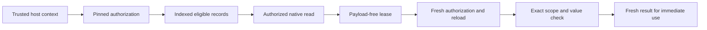

# Optional Policy API And Evidence Reuse

This guide describes the downstream source/policy contribution, not an upstream release or a production activation procedure. Existing banks, adapters and unconfigured calls retain their behavior. Preparing a catalog does **not** make ordinary BEAM, CLI, MCP, Hermes, plugins, exports or old clients enforce policy. Do not put protected data through those paths until their parity/activation gates pass.

## Architecture And Authority

Bank selection chooses the database; the explicit policy API selects eligible records within it. Project selection narrows relevance, never permission. The trusted host authenticates every applicable participant, intersects permissions, fixes the actual destination and supplies fresh grants. `AccessContext`, `MemoryPolicy`, `BankReadGrant` and `EvidenceLease` are metadata, not credentials. Names, model arguments and chat titles cannot establish authority.

Source originals stay external. Policy source metadata and evidence leases do not contain original files or fetch them. Explicit [source expansion](source-expansion-contract.md) separately reauthorizes and verifies exact bytes. Keep embedding model identity/dimensions/preprocessing unchanged unless a separately qualified index operation changes them.



This diagram is the explicit API path only. A lease never bypasses the indexed reader and is never supplied directly to a model as authorization.

## Run The Complete Synthetic Example

From the exact contribution checkout or an environment with its exact wheel installed:

```bash
PYTHONPATH=. python examples/policy_evidence_demo.py
```

The example creates and destroys a private temporary database with a minimal synthetic native table. It does not open the default bank, read configuration or call a model/provider. It registers a deployment-defined vocabulary, binds one parent, creates conservative child lineage, issues and resolves a lease, then quarantines the parent and demonstrates descendant refusal. Expected output:

```json
{
  "resolved": true,
  "lease_contains_payload": false,
  "quarantine_epoch": 1,
  "old_lease": "access_denied",
  "native_rows_preserved": 2,
  "protected_mode_activated": false
}
```

Its `verify_fixture` is deliberately synthetic. Do not copy it into an authenticated service as an identity provider. The complete executable example is [policy_evidence_demo.py](../examples/policy_evidence_demo.py), and [the lease contract](policy-evidence-contract.md) states its precise boundary.

## API Reference

| API | Use and constraints |
| --- | --- |
| `PolicyDefinition(policy_id, version, levels)` | Ordered deployment-defined vocabulary, lowest first; 1-64 distinct labels. No mandatory government scheme |
| `AccessContext(...)` | Frozen effective principal/context epoch, policy/version, ceiling, purpose, assurance, allowed banks/projects, compartments/audiences, operations and destinations. All participant intersection is a trusted-host responsibility |
| `context.narrow(*, banks=None, projects=None, operations=None, destinations=None)` | Exact subsets only; empty means none, not all. It does not authenticate or authorize a row |
| `bind_access_context(context)` | Request-local context manager; always scope it with `with`. Do not mutate a shared global context between interleaved conversations |
| `PolicyStore(conn).prepare(domain_id)` | Explicit owner-mode v1 catalog preparation. No backfill, protection switch or permission inference |
| `store.register_definition(definition)` | Register the exact immutable policy vocabulary/version |
| `store.bind(kind, record_id, policy)` | Bind metadata to an existing native record. Owner mode only, not authenticated agent creation |
| `PolicyLifecycle(store).prepare()` | Explicit atomic v1-to-v2 upgrade; requires a prepared v1 store. No automatic legacy-row normalization |
| `lifecycle.epoch()` | Current catalog epoch within this connection's snapshot. A reader's stale snapshot is **not** a fresh authority source |
| `lifecycle.bind_derivative(child, parents)` | Atomic conservative child binding plus exact supporting edges; 1-128 unique active parents, fresh child, at most 4096 derivative records |
| `lifecycle.quarantine(record, reason=QuarantineReason.REVOKED)` | Monotonic transitive quarantine for revoked/corrected/deleted evidence; native rows retained; no implicit reactivation |
| `BankReadGrant(..., *, lifecycle_epoch=None)` | Trusted bank-wide scope. V2 requires a freshly verified epoch; v1 uses `None` |
| `ProjectReadGrant(..., projects=..., *, lifecycle_epoch=None)` | Exact confirmed-project selection under trusted grants. Empty selection does not become bank-wide |
| `PolicyReader(store, *, bank, verify_context)` | Explicit synchronous trusted verifier; no verifier is inferred from configuration or model input |
| `reader.get(kind, record_id, *, destination, projects=None)` | Fresh authorized native record or `None` for denied/missing. Requires bank or exact project operation as appropriate |
| `reader.candidate_ids(kind, *, destination, limit=100, offset=0, projects=None)` | Authorized identity/provenance only, no native content. Maximum limit 1000 |
| `reader.get_source_revision(revision_id, *, destination)` | Exact authorized source metadata; requires `read:bank` and `read:source-revision`, no project selection, locator or bytes |
| `PolicyEvidence(reader).issue(kind, record_id, *, destination, projects=None)` | New authorized read producing a payload-free lease. V2 only; caller transactions refuse |
| `evidence.resolve(lease)` | Fresh authorization plus native reload, exact scope/epoch/binding/value comparison and final checkpoint. Does not return an old cached payload |

`RecordKind` covers working, episodic and canonical native records plus source revisions. Source revisions use the dedicated metadata API, not generic `reader.get`. Existing explicit lexical/vector/hybrid methods are documented in [lexical](policy-lexical-contract.md), [vector](policy-vector-contract.md) and [hybrid](policy-hybrid-contract.md) contracts. Native vector recall accepts a caller-supplied embedding and exact model identity; it does not silently invoke a provider. Native float32 and int8 are supported; unknown formats refuse. Do not replace ordinary recall with the explicit API without completing its surrounding adapter contract.

Import APIs from their defining modules as shown in the example, not an invented top-level SDK export. `EvidenceLease(record_kind, record_id, binding_id, bank, destination, projects, lifecycle_epoch, scope_fingerprint, value_fingerprint)` has no content or locator field. A resolved native `AuthorizedMemory` adds current `content` to identity/provenance; `AuthorizedSourceRevision` instead adds asset/digest/representation/byte-size assertion metadata. Read provenance includes bank, binding, policy ID/version/classification, current decision ID, context ID/epoch and lifecycle epoch. A lifecycle receipt contains `epoch`, `status` and `transaction_state`; `pending` needs the owner's commit. Result representations omit fields, but explicit serialization is not automatically privacy-safe.

Authenticated creation uses `PolicyWriter` and request-bound `MemoryWriteIntent`/`MemoryWriteGrant`, documented in [guarded creation](policy-write-contract.md). It creates native text, FTS and immutable policy atomically, not embeddings or enrichment. It does not silently deduplicate, update, reclassify or delete existing records. Owner-mode `store.bind` is not a substitute for that write grant.

## Trusted Verifier Contract

The reader calls `verify_context(context, *, bank, destination)` or adds `projects=<exact selection>` for project mode. It must be synchronous and return the correct `BankReadGrant`/`ProjectReadGrant`; awaitables refuse. Verify the context fingerprint against current authenticated host state, not just the supplied record. Check the actual target bank/destination, complete participant set, purpose, current grants, owners/tenants and current policy/context epoch. For v2, obtain the lifecycle epoch through independently current authority, not a caller-held reader snapshot. A fresh separate connection can serve a serialized local authority; distributed identity changes require the host's own freshness/transaction protocol.

The core pins the verified scope before candidate/content/vector consumers. Later verifier calls may issue different decision IDs but must not broaden, narrow or otherwise change the pinned scope mid-operation. Host exceptions become `context_unavailable`; missing/mismatched context, stale epochs and unsupported behavior fail closed. `PolicyReader` is not an authentication service and does not discover all conversation participants.

## Leases, Caches And Delivery

A lease includes record kind/ID, binding ID, bank, destination, exact project selection, lifecycle epoch and scope/value digests. Its default representation hides fields, but explicit serialization can expose sensitive IDs or permit digest guessing. Store it only where that metadata is authorized; do not put it in public logs. A lease is not signed or a transferable capability. A caller constructing one must still pass all current authorization checks.

Do not cache returned memory text as a reusable authorization result. Retain the payload-free lease, resolve it immediately before a new tool/model/provider input, and use only the fresh result. Context changes, changed grant scope, correction/revocation, native record changes or a different destination invalidate old leases. Any store quarantine advances the epoch and conservatively invalidates unrelated older leases too. Reissue through a new authorized read when appropriate; never silently update the old lease's epoch.

This provides a cooperative reuse gate, not universal cache interception. It cannot erase plaintext already held by another caller, retract emitted speech/text, cancel blocked verification or close the race after its final check. No provider runner, stream wrapper or background messaging loop is installed. Long-running delivery and every external cache/provider adapter still require their own qualified gates.

## Transactions, Defaults And Errors

Preparation, binding and quarantine can join owner transactions and return pending receipts where defined. The owner must commit or roll back; pending is not durable acceptance. Lease issue/resolve refuse **any caller transaction**, including a preserved WAL snapshot, so uncommitted state cannot issue reusable external evidence. Failed lease reads preserve the caller's pending work and do not leak an owned transaction.

Absent classification normalizes to `unclassified` only through the explicit [normalization helper](policy-derivation-contract.md) and only if that vocabulary defines it. It never grants public access or overrides stricter inheritance. Invalid explicit labels refuse; existing rows are not automatically migrated. Different owner/tenant conjunctions that cannot be safely represented refuse during inheritance.

Catch `PolicyRefusal` and inspect its fixed `reason` value; do not include denied IDs, labels, payloads or arbitrary exception text in public diagnostics. `PolicyStoreError` distinguishes `unprepared` and `incompatible`; it is not permission to repair a protected marker or fall back to legacy. Real I/O/locking errors remain failures. Cancellation propagates as its original exception while completed payload frames are cleared; this is not forensic memory erasure or complete timing-side-channel protection.

The refusal vocabulary is `missing_context`, `policy_mismatch`, `invalid_selection`, `unsupported_surface`, `access_denied`, `context_unavailable` and `resource_limit`. Source expansion separately uses `changed`, `missing`, `inaccessible`, `unavailable`, `unverified` and `limit_exceeded`; it defaults to 65,536 transient bytes and caps at 1,048,576. These statuses do not authorize retry in a different bank, source revision or legacy mode. Source metadata and bytes are different operations with different results.

## Compatibility And Acceptance

There is no new CLI flag, policy plugin hook or REST endpoint in this contribution. Preparing v2 makes older **explicit policy** readers refuse the version, not older ordinary native clients. Whole-database restore can restore an older epoch. Adapter parity, protected-store downgrade refusal, revocation-safe restore, export/sync/maintenance/audit, real resolver confinement and compact evidence recall remain separate acceptance gates. Do not claim complete protected operation because this example passes.

Run `python -m pytest -q tests/test_policy_evidence.py` for the focused synthetic contract. The downstream contribution ledger pins exact runtime/artifact identities, supported interpreter results, independent review, performance samples, unavailable host fixtures and remaining gaps. API examples are executed by tests so their documented result is checked rather than aspirational.
