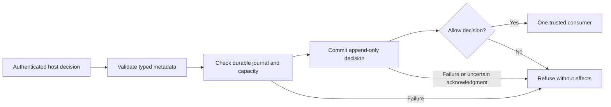

# Explicit Policy Decision Audit

Status: downstream P3 contribution based on accepted P3e `c079623`, not automatic auditing of ordinary clients or completion of protected activation. The journal records decisions without storing memory/prompt/query text. It does not discover principals, authorize memory access, derive classification or change existing banks. Keep its explicit metadata connection in trusted host code and outside the model's filesystem/tool surface.

## Data And Authority

`PolicyAuditEvent` contains bounded event/decision identities, fixed operation and `PolicySurface`, context ID/epoch/fingerprint, applicable principals, policy ID/version, bank/destination, lifecycle epoch, allow/deny result, fixed refusal reason and at most 256 requested/returned typed record references. A deny event cannot return records. There is no arbitrary payload, query, prompt, locator, filename, tool output, exception-message or memory-body field. IDs and other metadata can themselves be sensitive; this is content-free decision metadata, not public telemetry. The trusted host must supply opaque identities and must not put secret values or prose into metadata labels.

`PolicyAuditEvent.from_context(trusted_context, **decision_fields)` copies explicit effective context metadata; it does not authenticate the context or grant authority. A forged event or grant object never establishes permission. The host authenticates every participant and applies their permission intersection before constructing an allow event. Surface/operation pairs come from a fixed allowlist. Existing memory/source identities are preserved, not replaced with content hashes or public names.

The owner explicitly supplies a separate SQLite connection, fixed domain/bank and `verify_read` callback to `PolicyAudit`. Construction prepares nothing. `prepare(max_events=4096)` atomically creates the exact journal in an empty metadata database, refuses a preexisting legacy/native database or partial/incompatible journal, and never backfills memories. Capacity is 1-16,384 events; each canonical metadata event is at most 65,536 ASCII JSON bytes. These are logical admission bounds, not physical disk/WAL/backup erasure guarantees. No implicit truncate, rollover, deletion, eviction, upload or widening of retention occurs at capacity. Further protected work requiring audit must stop until separately authorized archival/retention handling is available.

`append(event)` is an owner report, not a model tool or permission service. It appends a checksummed canonical event and UTC timestamp. An exact event-ID retry returns the original sequence/status without another row; reuse with different content or corrupt retained payload refuses. SQL triggers prohibit event UPDATE/DELETE, and each operation checks exact table/trigger/state definitions including unexpected main/temp triggers. An arbitrary raw database owner can alter schemas or recompute hashes; this is not tamper-proof storage against that owner. Existing IDs, shared snapshots and caller transaction ownership remain intact.

`AuditWriteReceipt(sequence, status, transaction_state)` is sensitive metadata. `pending` joins a caller transaction and is not durable until its owner commits. `committed` reports the successful SQL commit; durable admission has additional requirements below. Unknown commit acknowledgment must not be silently converted to success or automatically retried. The same event can already exist after an interrupted acknowledgment.

## Administrative Reads

`read(*, destination, after_sequence=0, limit=100)` returns an immutable tuple of `AuditRecord(sequence, recorded_at, event)`. Limit is 1-1000, sequence fits a nonnegative signed SQLite integer, and pagination is increasing sequence order. No unprotected count/search/debug endpoint is added. Rows are bounded and read as bytes before UTF-8/JSON decoding, including timestamp/digest/event-ID columns, so malformed or oversized metadata produces a fixed refusal without a payload-bearing SQLite text decoder error. Checksums, canonical format, row identity and bank must match.

Require a bound authenticated `AccessContext` with `audit:read`, exact bank/destination and a synchronous trusted `verify_read(context, *, bank, destination)` callback. It returns exact `AuditReadGrant(context_fingerprint, domain_id, bank, destination, decision_id, authority_epoch)`. This is a distinct administrative grant, not an ordinary memory read grant. It must authorize the entire bank-partitioned journal for the effective participants, current ceiling/purpose and metadata sensitivity; broad independent administrator privileges may not expand a lower-privilege shared conversation. The host must deny if it cannot establish that whole-journal authorization. Per-event public/partial journal access is unsupported.

Check authority before database-state disclosure, again immediately before selecting event metadata and after closing the read snapshot. Pin context/domain/bank/destination/authority epoch across all checks; a fresh decision ID may differ. Missing, mismatched, stale, deferred or unavailable authority refuses. Caller-held transactions refuse after authorization rather than returning a stale snapshot. No permission or epoch is cached. This is cooperative current-authority enforcement, not a linearizable revocation barrier or timing-confidentiality guarantee.

## Fail-Closed Admission

`admit(event, consumer)` records an already host-authorized decision before one trusted synchronous `consumer(event)` returning `None`. The callback is host code, never a supplied shell command or model-generated function. Denied events are recorded then refused without invoking the consumer. A full/unprepared/incompatible/unavailable journal, a pending owner transaction, missing durability profile or commit failure refuses protected work. Deferred consumers refuse before append; non-None/deferred returns refuse after invocation, when effects may already have occurred. Callback exceptions/cancellation propagate with completed payload frames cleared. No implicit retries or remote acknowledgment are provided.

Admission requires a file-backed journal with either WAL plus `synchronous=FULL/EXTRA`, or DELETE plus `synchronous=EXTRA`. In-memory, OFF/NORMAL sync, rollback FULL and unqualified journal modes refuse. The API reads these settings but does not silently change them. The host must provision private paths, permissions, filesystem ownership and the durable profile explicitly. SQLite's [synchronous documentation](https://sqlite.org/pragma.html#pragma_synchronous) distinguishes rollback FULL from EXTRA and WAL FULL. OS/VFS/hardware must honor synchronization; tests do not simulate physical power loss. Audit creation/backup/retention and cross-host storage remain separate operational contracts.

A durable allow event records a policy decision, not completion of the subsequent operation. A callback may fail after external effects; an exact metadata retry does not deduplicate those effects. Repeating an explicit `admit` call can invoke the consumer again. After an uncertain acknowledgment or disconnect, inspect operation-specific receipts/history rather than blindly resending. A committed audit row may remain even when the operation never ran, which is safer than executing an unaudited operation. No cross-database or remote-effect atomicity is claimed.

## Integration And Acceptance

This seam is explicit. Existing core/CLI/MCP/Hermes/providers, derivation, export, sync, restore and administrative operations are not automatically wrapped. P4 must bind actual operations, contexts, destinations, audit events and current storage authority before exposing them. Record a denial for an unsupported protected path and never invoke its legacy handler. Declassification, broader disclosure, retention changes and source/destination policy transitions need their own authorized history records before those operations can be enabled; this decision journal does not implement those mutations. No protected activation or production migration follows from journal tests.

Use disposable synthetic journals to test exact retry/conflict, Unicode and oversized metadata, malformed UTF-8/digests, capacity, unknown schema/trigger shadowing, immutable rows, grant/context/epoch changes at every phase, no payload SELECT before authorization, caller rollback, interrupted CREATE/INSERT/commit acknowledgments, callback errors and no consumer after audit failure. Validate native/default legacy paths, interpreter/package compatibility and measured cost separately. No final V3/V5/V6/V8/V10 or full A/B scenario is promoted solely by this contribution.
