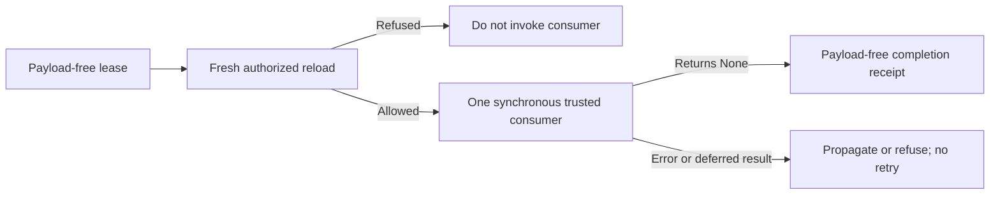

# P3d: Explicit Evidence Delivery Gate

Base: accepted PERF1 `df48870`. Add one explicit synchronous consumer boundary to `PolicyEvidence`; no schema, defaults, automatic provider routing, background delivery, protected activation or live changes. This is a bounded P3 contribution, not completion of streaming, adapters, audit, export/sync or revocation-safe restore.

## Interface And Trust

`PolicyEvidence.deliver(lease, consumer)` reloads and reauthorizes the exact lease through `resolve` immediately before calling a trusted synchronous `consumer(authorized_result)`. The consumer must finish synchronously and return `None`. The result is a frozen `EvidenceDeliveryReceipt` containing the original payload-free lease and fresh decision/context identifiers. It is sensitive metadata, not an authorization credential, public audit record or proof that a remote provider received anything. Constructing a receipt grants no access.

Only a lease, not a previously cached result, may enter delivery. All existing context, destination, project, bank, source/native identity and independently current lifecycle-epoch checks apply. Revocation, changed content or unavailable authority must prevent invocation. No source fetch occurs. Each explicit call invokes the consumer at most once, with no retries, deduplication, asynchronous loop or implicit delivery queue. Repeating a successful call intentionally delivers again; the trusted host owns idempotency and any external acknowledgment.

Reject coroutine, async-generator and generator functions (including callable objects) before resolving. If a nominally synchronous callable returns deferred work or any non-`None` result, refuse after the callback; close returned native coroutines/generators without running them. This cannot undo callback side effects. Propagate callback cancellation/errors with original exception identity and clear completed payload-bearing traceback frames using the existing output guard. A failed callback may already have consumed data: never automatically resend after failure or disconnect.

The consumer is trusted owner code, not a sandbox. It must not queue plaintext for later use, change destination, or use it after an authority change without another delivery check. The engine cannot make a check and arbitrary external side effects atomic, interrupt a blocked callback, stop a callback that ignores revocation, retract emitted bytes or inspect downstream transport state. There is no streaming implementation here. A host must gate each later submission and implement cancellation at the actual transport; ordinary provider/adapter paths remain unqualified. Caller transactions and unsupported stores keep the existing `resolve` refusals.

## Acceptance

Use only synthetic disposable v2 stores. Prove fresh decision IDs and no native writes; supported native/source records; denied, missing, stale, changed and forged leases never invoke the consumer; context/destination changes and A/B/A interleaving refuse unsafe reuse; quarantine during one callback blocks the next delivery. Reject deferred callables before any read, reject deferred return values without running them and preserve callback exception/cancellation identity while clearing completed payload frames. Test caller transactions, legacy catalogs, thread/task context boundaries and explicit repeat delivery. Verify receipt contents are payload-free and immutable, and preserve existing public APIs.

Compare unchanged direct/issue/resolve/denied workloads against the preceding checkpoint before acceptance. Measure the new delivery path separately against manual `resolve` plus the same no-op consumer, with exact output/callback/authority/write oracles. Qualify focused interpreter, selected regression and installed-artifact paths; document limitations without declaring any global V checkbox complete.

## Qualified Checkpoint

Runtime `d0e54b62a0f6eb06bbfbcdda62093b22b1e43354`, base PERF1 `df48870f3ef2ccc8de5e91fad3a4cb2bade3513e`. The only production change is additive delivery/receipt code in `policy_evidence.py`; existing resolve, reader, store, authority and transport algorithms are unchanged. The example exercises delivery while preserving its existing output contract. All 46 new / 217 combined delivery/lease/lifecycle/fingerprint cases pass on each Python 3.10-3.14. Selected regressions pass 1,950 plus two unavailable real-Hermes-loader skips. Source-adapter tests with matching isolated distribution metadata pass 759 plus one pinned-host skip. Changed/fatal lint, generated docs and diff checks pass, not full upstream CI.

Independent review passes 30 probes, including interleaved tasks, inherited task context with subsequently revoked authority, source/project grants, final-checkpoint changes, deferred callable forms, exception chains/groups and payload-frame cleanup. All 685 tracked hashes, status and HEAD are unchanged. Its initial 28-case run had 25 passes and three harness failures: network tripwires blocked asyncio's local AF_UNIX self-pipe. Original failures remain; corrected tripwires plus two supplemental probes pass without a product change. Cursor's output-free review attempt was terminated and has no review credit.

Exact-source, source-excluded installed minimal/native controls verify 165 RECORD hashes, retained source/quarantine/fingerprint/float32/default-int8[1024] checks and new delivery/cancellation/revocation behavior. Core/adapter wheel SHA-256: `efeac4af8d13eb5fb8f824dd60821b28fc39177f8e5000115f590ea1a9d31dfd` / `6afec8bb3ca6cba042be18f7334322279aec69d31741222948b83aee42609d15`. Development labels remain core `4.0.0b5` / adapter `0.7.6`; these are not releases. Initial harness runs omitted five legacy pins, used stale adapter 0.7.5 metadata, then selected an installed layout for a source-editable test, and omitted the native fixture's embedding settings. Each original result is retained; final runs verify source imports, matching metadata and explicit synthetic BAAI/bge-m3/1024 settings without touching live configuration. The metadata mismatch also reproduces on the predecessor.

Five alternating unchanged four-shape comparisons retain 500 samples/shape/source and identical verifier/output/write oracles. Predecessor/candidate p50/p95 milliseconds: direct 0.850/1.051 versus 0.839/1.053, issue 1.336/1.603 versus 1.305/1.547, resolve 1.296/1.568 versus 1.278/1.494, denied issue 1.092/1.328 versus 1.085/1.294. These small shared-host differences do not establish a causal speedup. A separate identical four-shape manual/delivery workload retains two five-round observations. Confirmation allowed median/p95 is 1.305/1.574 ms manual versus 1.311/1.685 ms delivery; denied is 1.097/1.540 versus 1.122/1.597 ms. Fresh successful verifier counts are 525 per 105 operations on both paths; denied counts are 420 and no denied callback runs.

The first delivery workload has larger tails, retained rather than discarded: allowed delivery p95 3.783 ms versus manual 1.602 ms; manual denied p95 3.370 ms versus delivery denied 1.468 ms. Other project test workloads were active on the shared host, but interference is not proven to be the sole cause. The large shift does not repeat in confirmation; this is not a passed overall protected-mode budget or timing-confidentiality result. Each observation has zero native read writes, detected provider/network attempts or false allows. Process RSS, semantic quality, real transport and scaling remain unmeasured. A complete scoped static scan adds one CA100 complexity heuristic for `deliver` beside the existing orchestration finding; no score-only refactor was added.

No source fetch, model call, live store, migration, activation, upstream submission or upstream changelog change is included. Remaining ordinary retrieval/mutation paths, actual provider/stream gates, audit/export/sync/maintenance, revocation-safe restore, P4 and R1 remain substantive work.
